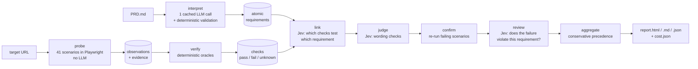

# DemoBank QA agent

An autonomous, specification-driven QA agent. Give it a PRD and a URL; it extracts verifiable
requirements, drives the site in a real browser through normal, negative and edge scenarios, checks the
side effects (balances, transaction rows, filters, error states), and reports every requirement as
**passed**, **failed** or **unverified**, with evidence, reproduction steps and a cost breakdown.

```bash
uv run qa-agent run --prd ../test-website/PRD.md --url http://localhost:5173
```

→ `runs/<timestamp>/report.html` (self-contained, screenshots inline), `report.md`, `report.json`,
`cost.json`. A curated report from a full run is in [`reports/`](reports/).

## Design principles

1. **A successful click is not a pass.** Every verdict comes from an oracle that compares what the PRD
   says with recorded facts: balances before and after, new transaction rows by identity, the API
   status, the visible message.
2. **Models interpret, code decides.** The language model reads the PRD once. Everything that can be
   computed — money arithmetic, filter set equality, masking, duplicate POSTs — is deterministic Python.
   Small semantic calls (does this check test that requirement? does this message explain the error?)
   go to TypeSafe Jev, which returns typed probabilities instead of prose.
3. **Uncertain means unverified, never a guess.** A failure is reported only after the failing scenario
   reproduces on a second run *and* a review confirms the observation violates that specific requirement.
   Anything the agent cannot establish is `unverified` with a reason.
4. **No answer key.** The target's source is never read for expected defects; nothing in the agent names
   a known bug. The evaluation harness that injects defects lives in `eval/` and is never imported by
   `qa_agent/` (enforced by a test).

## Pipeline



| Stage | Module | What it does | Model use |
|---|---|---|---|
| Interpret | `interpret/` | Splits the PRD into bullets deterministically, then one LLM call turns them into atomic requirements (id, area, quote, testability, assertions). Every quote must match the PRD text; one repair call if validation fails. Cached by PRD + model + prompt. | Gemini, once per PRD |
| Probe | `plan/`, `execute/`, `observe/` | 41 scenarios (SES 7, ACC 3, TRF 16, HIS 8, PRO 2, GEN 5), each normal, negative or edge: zero/negative/over-precision/over-balance amounts, same-account transfer, rapid double submit, date and type filters with boundary days, refresh and back-button access after logout, slow network, masking. Each runs in a fresh browser context and records steps, screenshots, API traffic and console errors. Mutating scenarios restore balances (net-zero). | none |
| Verify | `verify/` | Oracles per area turn observations into checks with expected/observed values. Filters: rows = unfiltered history ∩ predicate (set equality). Transfers: attributed by new row identity, balance deltas in `Decimal`. Masking: "not every digit visible", never a specific mask character. | none |
| Link | `verdict/link.py` | Two-stage Jev linking: rank check families per requirement, then per assertion ask "does this family test it?" and "does part of the requirement go untested?". Links are made against outcome-free family descriptions, so an observed failure cannot bias coverage. | Jev; Gemini for the uncertain band |
| Judge | `verdict/judge.py` | Wording checks ("clear", "readable") as narrow yes/no questions; ≥ 0.85 pass, ≤ 0.15 fail, else escalate or leave unknown. | Jev; Gemini escalation |
| Confirm | `verdict/confirm.py` | Re-runs every failing scenario once; only reproducible failures count. | none |
| Review | `verdict/review.py` | For each candidate failure: violates / condition not met / different behaviour / unsure. Only P(violates) ≥ 0.90 keeps the failure. | Jev |
| Aggregate | `verdict/aggregate.py` | failed = a confirmed, reviewed fail; passed = full coverage and every linked check passes; otherwise unverified with a reason (`partial_coverage`, `checks_unknown`, `probe_blocked`, …). | none |
| Report | `report/` | One JSON document rendered as a self-contained HTML page (textContent only, no injected markup) and Markdown. Failures show plain-language steps, expected vs observed, screenshots and the API calls involved. | none |

### Resilience

The browser harness never relies on fixed sleeps or brittle selectors:

- **Settling:** a SPA quiet window based on an in-page in-flight request counter (Playwright's
  `networkidle` fires only once per document), plus busy/disabled state detection.
- **Locators:** test id first, then role + accessible name, labels, table headers. When a control is
  missing, `recover/heal.py` snapshots interactive elements and matches by role and token overlap with a
  generic synonym table (from↔source, memo↔note, log out↔sign out…); a Jev choice is the fallback.
- **Recovery policies** (`recover/policy.py`): press the app's retry control once when a read fails with a
  server error, and retry a step whose element was detached or still animating (at most twice). A submission is
  never repeated, and recovery is off for session and error-handling probes. Losing the session mid-probe is
  deliberately not recovered: it may be the defect being tested, so the probe is blocked instead.
- **Chaos testing** (`chaos/`, injected into the agent's own browser only): relabelled controls, stripped
  test ids, 800 ms latency and one 503 per API path. The verdicts must not flip relative to the baseline;
  steps that cannot be healed become `blocked` → `unverified`.

## Results

### Local reference run

Full `qa-agent run` against a local copy of the target, 2026-10-21 — report in
[`reports/local-2026-10-21/`](reports/local-2026-10-21/) (open `report.html`).

**38 passed · 5 failed · 11 unverified** of 54 requirements; 41 / 41 scenarios completed.

| Failed requirement | What the agent observed |
|---|---|
| TRF-006 Invalid amounts rejected | A `0` transfer was accepted: HTTP 201, a new transaction row and "Transfer complete $0.00". |
| TRF-008 Over-balance transfer rejected | A transfer of balance + $0.01 was accepted and left the account at −$0.01. |
| TRF-011 No success state for a rejected transfer | The same over-balance transfer showed "Transfer complete" instead of a rejection. |
| HIS-007 Date-range filter | A single-day range (e.g. 2025-06-15 to 2025-06-15) returned no rows although the unfiltered history has a transaction that day; ranges drop rows on their end date. |
| HIS-009 Inclusive date boundaries | Same observation, against the boundary-inclusion requirement. |

Every failure was reproduced on a second run and confirmed by review. The unverified requirements carry a
reason: `partial_coverage`, `checks_unknown`, `flaky`, `no_linked_checks` or `not_testable` (e.g. a
requirement about the seed data's realism).

### Evaluation against injected defects

`eval/` builds patched copies of the target (served on separate ports, shared DB reset between runs) and
scores the agent's verdicts against ground truth. It is development-only tooling.

| Measure | Result (Jev only, no Gemini escalation) |
|---|---|
| Precision — reported failures that are real | **0.97** |
| Recall — expected failures found | 0.73 |
| False failures on the build with the known defects fixed | **0** |
| Injected defects detected | 3 / 7 (logout, type filter, same-account transfer) |

Every injected defect made at least one oracle fail; the misses are requirement links Jev scored in the
0.45–0.79 band, which by design escalate to Gemini (not used in that run). Thresholds were deliberately
not tuned on the evaluation set. Details: [`docs/P9_IMPLEMENTATION.md`](docs/P9_IMPLEMENTATION.md).

## Cost

Measured on the reference run above, starting from an empty decision cache (`cost.json`):

| Phase | Provider | Calls | Cost (USD) |
|---|---|---:|---:|
| Interpret PRD (+ 1 repair call) | Gemini `gemini-3.8-flash` | 2 | 0.1125 |
| Link checks to requirements | TypeSafe Jev | 447 | 0.0257 |
| Judge wording | TypeSafe Jev | 372 (+49 cached) | 0.0067 |
| Review failures | TypeSafe Jev | 6 | 0.0005 |
| Escalation of uncertain decisions | Gemini | 2 | 0.0311 |
| 41 browser scenarios, oracles, confirmation re-runs | — | 0 | 0 |
| **Total, cold run** | | | **≈ $0.18** |

Re-auditing with the same PRD skips interpretation (the catalogue is cached), so a repeat run costs at
most the decision phases — about $0.065 here — and less when decisions over unchanged inputs come from
cache. Gemini prices are paid-tier list prices; `gemini-3.8-flash` (interpretation and link escalation)
doubles from 2027-01-01, which would put this cold run at about $0.32.

Why it is cheap: the PRD is interpreted once and cached; 41 scenarios and all oracles run without a
model; the per-requirement decisions use Jev ($0.042 per million input tokens, output free) and every
answer is cached by its exact inputs, so re-running an unchanged site costs nothing for those phases.
The report shows both what the run billed and the cold-run cost. Prices are in `qa_agent/llm/meter.py`
(checked 2026-10-21); a model without a listed price is reported as unpriced and the total is marked as a
lower bound.

## Setup

Requirements: Python 3.12+, [uv](https://docs.astral.sh/uv/), and the target app (hosted URL, or local
per [`../test-website/LOCAL_SETUP.md`](../test-website/LOCAL_SETUP.md)).

```bash
cd agent
uv sync --extra dev
uv run playwright install chromium
cp .env.example .env        # then fill in GEMINI_API_KEY and TYPESAFE_API_KEY
uv run qa-agent doctor      # checks configuration, model access and that the target is reachable
uv run qa-agent run --prd ../test-website/PRD.md --url <target-url>
```

`.env` is gitignored; never commit keys. `GEMINI_API_KEY` is needed to interpret a new PRD (a cached
catalogue runs without it); `TYPESAFE_API_KEY` powers the decision phases, which use Gemini instead when
it is missing. A model call that fails mid-run leaves the affected requirements unverified rather than
crashing the run.

### Commands

| Command | Purpose |
|---|---|
| `qa-agent run --prd P --url U [--out DIR] [--no-confirm]` | Full pipeline and report. |
| `qa-agent interpret --prd P` | Requirement catalogue only. |
| `qa-agent probe --url U [--only ID] [--chaos labels,testids,slow,flaky] [--headed]` | Run scenarios and record observations. |
| `qa-agent verify --run DIR` | Re-evaluate oracles over recorded facts (no browser, no model). |
| `qa-agent verdict --run DIR --catalogue FILE` | Link, judge, confirm, review, aggregate. |
| `qa-agent report --run DIR --catalogue FILE` | Re-render the report. |
| `qa-agent chaos-compare` | Verdict changes between a baseline and a chaos run. |
| `uv run pytest` | Offline test suite (no network, no live model calls). |

## Repository layout

```text
agent/
├── qa_agent/
│   ├── interpret/   PRD splitter + one cached extraction call
│   ├── plan/        probe registry, reusable flows, 41-probe library
│   ├── execute/     Playwright harness and evidence capture
│   ├── observe/     DOM readers, money/date parsing (Decimal, never float)
│   ├── verify/      deterministic oracles per area
│   ├── verdict/     link, judge, confirm, review, aggregate
│   ├── recover/     self-healing locators and bounded recovery
│   ├── chaos/       browser-side perturbations for resilience tests
│   ├── llm/         Gemini client (timeouts, retry, fallback chain), Jev client, cost meter
│   └── report/      report data + self-contained HTML template
├── eval/            injected-defect evaluation harness (dev only)
├── tests/           offline pytest suite
├── docs/            phase designs and implementation notes
└── reports/         exported audit report from a full run
```

## Safety

Synthetic data only; the agent uses the site's visible **Enter Demo** flow and the app's own API calls.
No load testing, no requests outside the supplied application, and mutating scenarios restore the
balances they change.
