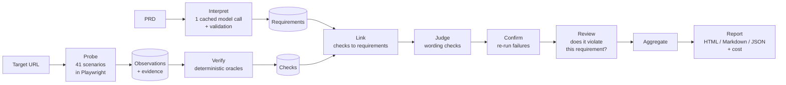

# DemoBank QA Agent

An autonomous, specification-driven QA agent. Given a product requirements document (PRD) and the URL of a
running web application, it answers one question: **does the application behave the way its specification
says it should?**

The agent reads the PRD, turns it into atomic, verifiable requirements, drives the application in a real
browser through normal, negative and edge-case scenarios, checks the resulting side effects (balances,
transaction records, filters, error states), and reports every requirement as **passed**, **failed** or
**unverified**, with evidence, plain-language reproduction steps and a cost breakdown.

```bash
uv run qa-agent run --prd ../test-website/PRD.md --url https://<target>
```

Open `runs/<timestamp>/report.html`. An exported report from a full run is in
[`reports/local-2026-10-21/`](reports/local-2026-10-21/).

---

## Contents

1. [Principles](#principles)
2. [What it tests](#what-it-tests)
3. [How it works](#how-it-works)
4. [How a verdict is decided](#how-a-verdict-is-decided)
5. [Resilience](#resilience)
6. [Results](#results)
7. [Cost](#cost)
8. [Setup](#setup)
9. [Usage](#usage)
10. [Output](#output)
11. [Repository layout](#repository-layout)
12. [Known limitations](#known-limitations)
13. [Safety](#safety)

---

## Principles

- **A successful click is not a pass.** Every verdict comes from an oracle that compares what the PRD requires
  with recorded facts: balances before and after, new transaction rows identified by id, the API response,
  the message on screen.
- **Models interpret, code decides.** A language model reads the PRD once. Everything computable (money
  arithmetic, filter set equality, masking, duplicate requests, request origins) is deterministic Python.
  Small semantic questions ("does this check test that requirement?", "does this message explain the
  problem?") go to TypeSafe Jev, which returns typed probabilities instead of prose.
- **Uncertain means unverified, never a guess.** A failure is reported only when the failing scenario
  reproduces on a second run *and* a review confirms the observation violates that specific requirement.
  Anything the agent cannot establish is `unverified`, with the reason.
- **No answer key.** The agent never reads the target's source code and contains no knowledge of specific
  defects. Expected behaviour comes from the PRD alone.

## What it tests

41 scenarios across every PRD area, each classified as normal, negative or edge. Scenarios read their inputs
from the live data (current balances, the dates present in history), so boundaries follow whatever the
deployment contains.

| Area | Scenarios | Examples |
|---|---:|---|
| Session | 7 | Enter Demo, double-click Enter, logout, protected pages without a session, back button and refresh after logout, refresh keeps the session |
| Accounts | 3 | Dashboard fields and masking, account detail, unknown account id with recovery |
| Transfers | 16 | Valid transfer with and without memo; 0.01 minimum; exact balance; balance + 0.01; same account; blank, whitespace, zero, negative, non-numeric and over-precision amounts; rapid triple submit; submit on a slow network |
| History | 8 | Combined and per-account history; filters by account, type, status, date range (including single-day and boundary dates), all combined; empty result; clearing filters |
| Profile | 2 | Masked profile details; no secrets, tokens or full identifiers anywhere in pages, storage or API traffic |
| General | 5 | Desktop, tablet and phone layouts; navigation destinations; loading states; recoverable errors; unknown routes |

Across all scenarios the agent also checks that the browser never sends data to a host outside the
application, and that no out-of-scope feature (signup, bill-pay, loans, cards, multi-user) is offered.

## How it works



| Stage | What it does | Model use |
|---|---|---|
| **Interpret** | Splits the PRD into bullets, then one model call turns them into atomic requirements, each quoting the PRD verbatim with its assertions. Code validates every quote and that every bullet is covered; one repair call if not. Cached by PRD, model and prompt. | Gemini, once per PRD |
| **Probe** | Runs the scenarios, each in a fresh browser context. Records every step, screenshots, API traffic, console errors and request origins. Scenarios that move money restore the balances afterwards. | None |
| **Verify** | Oracles turn observations into checks with expected and observed values. Filters: the filtered rows must equal the unfiltered history matched against the filter. Transfers: attributed by new transaction ids, balance changes in exact decimals. Masking: "not every digit visible", never a specific mask character. | None |
| **Link** | Decides which checks test which requirement. Jev ranks check families per requirement assertion, then confirms each candidate and asks whether part of the assertion goes untested (partial coverage). Families are described without outcomes, so an observed failure cannot influence linking. | Jev; Gemini for uncertain links |
| **Judge** | Wording checks ("clearly labeled", "clear message", "direction shown") as narrow yes/no questions on the exact visible text. | Jev; Gemini for uncertain answers |
| **Confirm** | Re-runs every failing scenario. Only failures that reproduce count. | None |
| **Review** | For each candidate failure: does the observation violate this requirement, does the requirement's condition not apply, or is it a different behaviour? | Jev; Gemini for uncertain reviews |
| **Aggregate** | Applies the verdict rules below. | None |
| **Report** | A single self-contained HTML page (screenshots inline), plus Markdown and JSON. | None |

## How a verdict is decided

| Verdict | Rule |
|---|---|
| **Failed** | A linked check failed, the failure reproduced on a re-run, and the review judged it a violation of this requirement with probability ≥ 0.90. |
| **Passed** | The requirement is fully covered by linked checks and every one of them passed. |
| **Unverified** | Anything else, with a reason: `partial_coverage`, `no_linked_checks`, `checks_unknown`, `needs_judgement`, `flaky`, `unconfirmed`, `probe_blocked`, `link_disputed`, `concurrent_activity`, `not_testable`. |

Model decisions use fixed thresholds: a wording judgement passes at ≥ 0.85 and fails at ≤ 0.15, a link
needs ≥ 0.80, and a failure needs a review of ≥ 0.90. Anything in between goes to Gemini, and if no model
can decide, the item stays unverified. A model outage never produces a pass.

Every failure in the report shows the requirement, the steps to reproduce in plain language, expected versus
observed values, screenshots and the relevant API calls.

## Resilience

- **No fixed sleeps.** Pages are considered settled when no API request is in flight for a quiet window and
  no busy indicator is shown. Playwright's `networkidle` fires only once per page load, which is wrong for a
  single-page app.
- **Semantic locators.** Test ids first, then role and accessible name, labels and table headers.
- **Self-healing.** If a control is missing, the agent snapshots the interactive elements and matches by role
  and wording, using a generic synonym list (from/source, memo/note, log out/sign out). A Jev choice is the
  fallback. Every heal is recorded as evidence.
- **Bounded recovery.** The agent presses the app's retry control once after a server error, and retries a
  step whose element was detached or still animating. It never repeats a submission. Losing the session
  mid-scenario is not recovered: it may be the defect under test, so the scenario is reported as blocked.
- **Chaos testing.** `--chaos labels,testids,slow,flaky` perturbs the agent's own browser: relabelled
  controls, stripped test ids, 800 ms latency, one injected 503 per API path. The verdicts must not change
  compared with a clean run.

## Results

### Reference run

Full run against a local copy of the target, 2026-10-21. The report is in
[`reports/local-2026-10-21/`](reports/local-2026-10-21/) (open `report.html`).

**38 passed · 5 failed · 11 unverified** of 54 requirements; 41 of 41 scenarios completed.

| Failed requirement | What the agent observed |
|---|---|
| TRF-006 Invalid amounts rejected | A `0` transfer was accepted: HTTP 201, a new transaction row and "Transfer complete $0.00". |
| TRF-008 Over-balance transfer rejected | A transfer of balance + $0.01 was accepted and left the account at −$0.01. |
| TRF-011 No success state for a rejected transfer | The same over-balance transfer showed "Transfer complete" instead of a rejection. |
| HIS-007 Date-range filter | A single-day range returned no rows although the unfiltered history has a transaction that day; ranges drop rows on their end date. |
| HIS-009 Inclusive date boundaries | Same observation, against the boundary-inclusion requirement. |

Every failure was reproduced on a second run and confirmed by review.

### Evaluation against injected defects

The `eval/` harness builds patched copies of the target, each with one known defect added (masking removed,
logout not revoking the session, type filter ignored, same-account transfers accepted and others) plus a
build with the shipped defects fixed. It then scores the agent's verdicts against the expected results.

| Measure | Result (Jev only, no Gemini escalation) |
|---|---|
| Precision: reported failures that are real | **0.97** |
| Recall: expected failures found | 0.73 |
| False failures on the build with the shipped defects fixed | **0** |
| Injected defects detected | 3 of 7 |

Every injected defect made at least one oracle fail. The misses are requirement links that Jev scored as
uncertain; those are designed to go to Gemini, which this measurement did not use. Thresholds were not tuned
on the evaluation set.

## Cost

Measured on the reference run, starting from an empty cache:

| Phase | Provider | Calls | Cost (USD) |
|---|---|---:|---:|
| Interpret PRD (+ 1 repair call) | Gemini `gemini-3.8-flash` | 2 | 0.1125 |
| Link checks to requirements | TypeSafe Jev | 447 | 0.0257 |
| Judge wording | TypeSafe Jev | 372 | 0.0067 |
| Review failures | TypeSafe Jev | 6 | 0.0005 |
| Escalation of uncertain decisions | Gemini | 2 | 0.0311 |
| 41 browser scenarios, oracles, confirmation re-runs | none | 0 | 0 |
| **Total** | | | **≈ $0.18** |

Why it is cheap:
- The PRD is interpreted once and cached.
- Scenarios, oracles and re-runs use no model.
- Decisions use Jev ($0.042 per million input tokens, output free).
- Every model answer is cached by its exact inputs, so re-auditing an unchanged application costs only the
  decisions about what changed.

Every report shows two figures: what the run was billed, and what it would cost with an empty cache. Prices
live in `qa_agent/llm/meter.py` (paid-tier list prices, checked 2026-10-21; `gemini-3.8-flash` doubles from
2027-01-01). The Flash fallback models (`gemini-3.7-flash`, `gemini-3.5-flash`, `gemini-flash-latest`) are not
on Google's price page and are priced like `gemini-3.8-flash` as an estimate. A model without any price, or a
cached answer whose token usage was not recorded, is flagged and the total marked as a lower bound.

## Setup

**Requirements:** Python 3.12+, [uv](https://docs.astral.sh/uv/), a Gemini API key, a TypeSafe API key, and the
target application (its URL, or a local copy per
[`../test-website/LOCAL_SETUP.md`](../test-website/LOCAL_SETUP.md)).

```bash
cd agent
uv sync --extra dev
uv run playwright install chromium
cp .env.example .env          # fill in the keys
uv run qa-agent doctor        # checks configuration, model access and that the target is reachable
```

### Configuration (`agent/.env`)

| Variable | Purpose |
|---|---|
| `GEMINI_API_KEY` | Interpreting the PRD and resolving uncertain decisions. |
| `GEMINI_MODEL_PLANNER`, `GEMINI_MODEL_FAST` | Models for interpretation and for quick decisions. |
| `GEMINI_MODEL_FALLBACKS` | Models tried in order when one is overloaded or rate-limited. |
| `TYPESAFE_API_KEY`, `TYPESAFE_MODEL` | Jev decisions (linking, judging, review). Pinned model for reproducible verdicts. |
| `QA_TARGET_URL` | Default target for `doctor`. |

`.env` is gitignored; never commit keys. Without a TypeSafe key, the decision phases use Gemini. Without a
Gemini key, a previously cached requirement catalogue still runs. A model call that fails mid-run leaves the
affected requirements unverified rather than stopping the run.

## Usage

| Command | Purpose |
|---|---|
| `qa-agent run --prd FILE --url URL [--out DIR] [--no-confirm]` | Full pipeline and report. |
| `qa-agent interpret --prd FILE` | Build the requirement catalogue only. |
| `qa-agent probe --url URL [--only ID ...] [--chaos LIST] [--headed] [--list]` | Run scenarios and record observations. `--only` takes an id or prefix and can be repeated. |
| `qa-agent verify --run DIR` | Re-evaluate the oracles over a recorded run (no browser, no model). |
| `qa-agent verdict --run DIR --catalogue FILE` | Link, judge, confirm, review and aggregate. |
| `qa-agent report --run DIR --catalogue FILE` | Re-render the report. |
| `qa-agent chaos-compare --base DIR --variant DIR` | Verdict differences between a clean run and a chaos run. |
| `qa-agent doctor` | Configuration and connectivity check. |
| `uv run pytest` | Offline test suite: no network and no live model calls. |

For a repeatable local audit, reset the target's database first (`make reset` in
`test-website/database`), so leftover records from earlier runs do not affect the results.

## Output

Each run writes to `runs/<timestamp>/` (or `--out`):

| File | Contents |
|---|---|
| `report.html` | The audit report: summary, every requirement with its verdict and reason, failures with steps and evidence, how checks were linked, cost. Self-contained. |
| `report.md`, `report.json` | The same report as Markdown and as data. |
| `requirements.json` | The requirement catalogue derived from the PRD. |
| `observations.json` | Facts recorded by every scenario. |
| `evidence/<scenario>/` | Step log, screenshots, API traffic and console output per scenario. |
| `checks.json`, `checks.judged.json` | Oracle checks, before and after wording judgements. |
| `links.json` | Which checks were linked to which requirement, and why. |
| `confirm/` | Re-runs of failing scenarios. |
| `verdicts.json` | Final verdict per requirement. |
| `cost.json` | Every model call with tokens, cache status and cost. |

## Repository layout

```text
agent/
├── qa_agent/
│   ├── cli.py         command-line entry point
│   ├── interpret/     PRD splitter and requirement extraction
│   ├── plan/          scenario library, reusable UI flows, scenario runner
│   ├── execute/       Playwright harness and evidence capture
│   ├── observe/       page readers; money and date parsing (exact decimals)
│   ├── verify/        deterministic oracles per area
│   ├── verdict/       link, judge, confirm, review, aggregate
│   ├── recover/       self-healing locators and bounded recovery
│   ├── chaos/         browser-side perturbations for resilience testing
│   ├── llm/           Gemini and Jev clients, cost meter and prices
│   └── report/        report data and the HTML template
├── eval/              injected-defect evaluation harness (not used by the agent at runtime)
├── tests/             offline test suite
└── reports/           exported audit report
```

## Known limitations

- **Decisions near a threshold can vary between runs.** Wording judgements and requirement links that Jev
  scores in the uncertain band go to Gemini, whose answers can differ across runs. A requirement decided
  that way can move between passed, failed and unverified from one run to the next. Deterministic checks do
  not vary.
- **Without Gemini, more requirements stay unverified.** If Gemini is unavailable (outage or exhausted
  quota), uncertain links and judgements cannot be resolved: those requirements are reported as unverified,
  never guessed. In testing this moved roughly 10 unverified requirements to roughly 36.
- **The requirement catalogue depends on the interpretation.** Interpreting the same PRD with a different
  model or prompt can split requirements differently and renumber them. The catalogue is cached, so repeat
  runs are stable; compare runs only when they use the same catalogue. The evaluation uses its own fixed
  catalogue for that reason.
- **Leftover records affect results.** Scenarios restore balances, but rejected-amount scenarios against a
  defective build create transactions that cannot be removed. On a shared or long-lived deployment these
  accumulate in history. Reset the database between local runs where possible.
- **Outside reads are not judged.** The request-origin check fails any data sent to a host outside the
  application, but a plain read from another host (a font or a CDN) cannot be told apart from a bank
  connection by origin alone, so it is reported as unknown rather than passed.
- **Some links are broader than they should be.** Linking can attach checks from a related scenario (for
  example overdraft checks to the same-account transfer requirement). Review then marks the requirement
  `link_disputed` and it stays unverified rather than passing or failing wrongly.
- **Timezone.** Date filters are evaluated in the timezone the application shows. If none is shown, only
  comparisons that hold in every timezone are decided; the rest are unknown.

## Safety

Synthetic data only. The agent uses the application's visible **Enter Demo** flow and only the requests the
application itself makes. It does no load testing, makes no requests outside the supplied application, and
restores the balances it changes.
